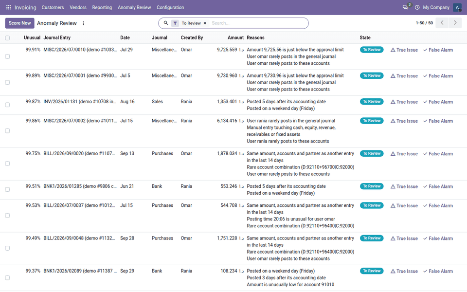
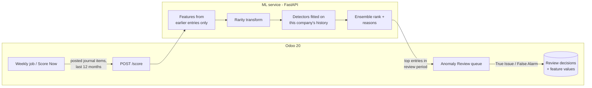
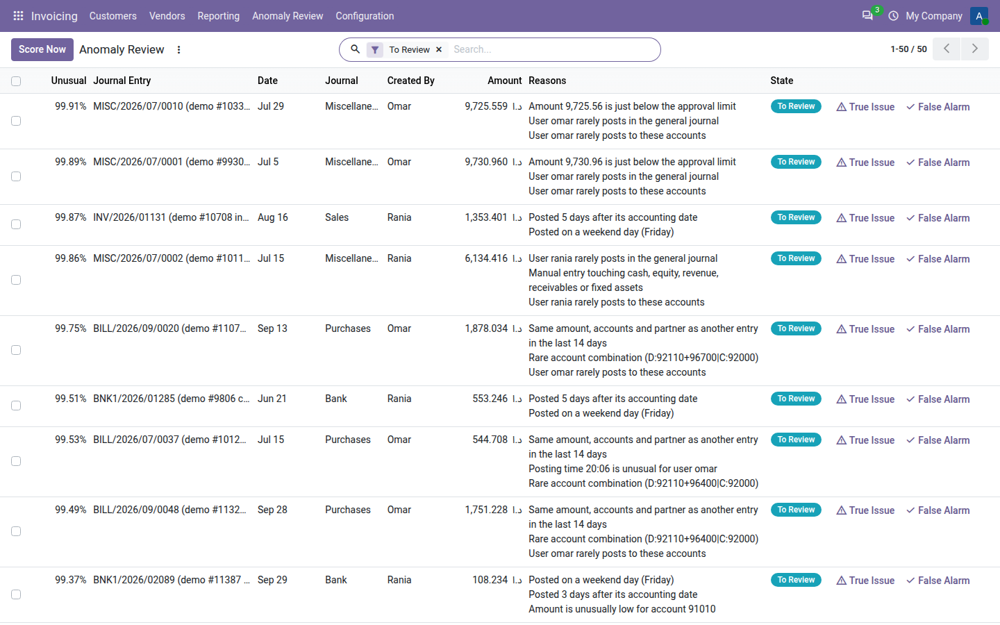
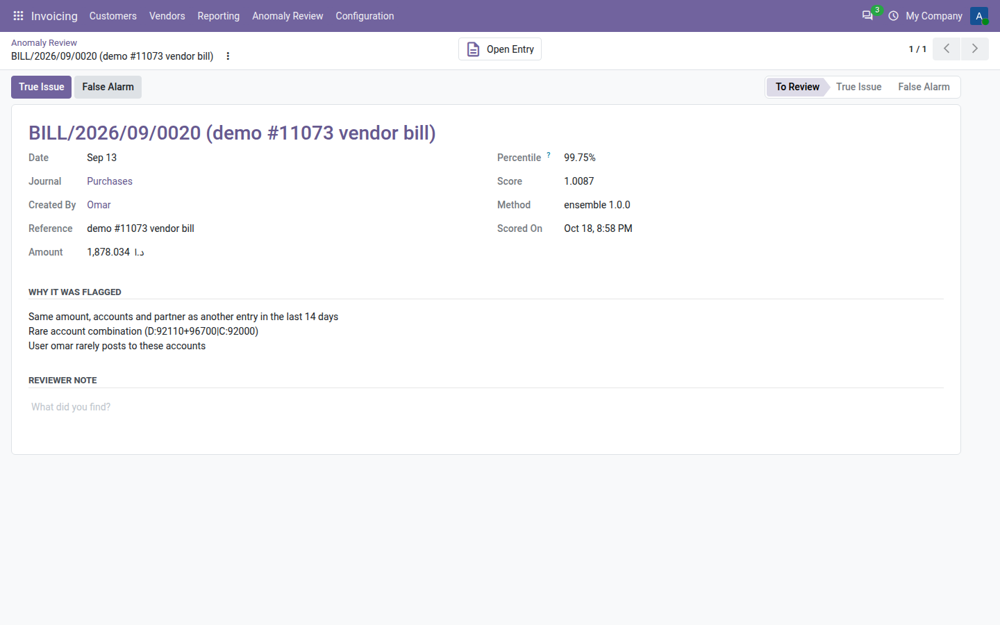
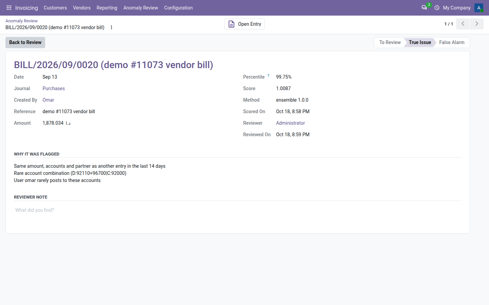
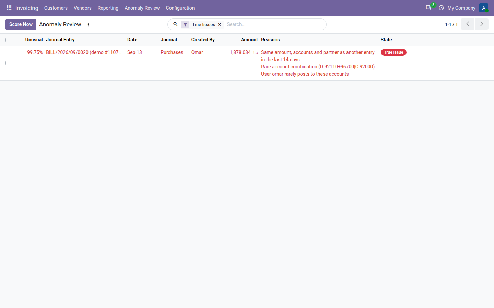

# Journal Entry Anomaly Detection

Unsupervised machine learning for **Odoo 20** that ranks posted journal entries by how unusual they are,
explains why each one was flagged, and gives reviewers a queue to mark each flag as a *True Issue* or a
*False Alarm*. No labelled data is needed. On every run, the detector learns what is normal from the company's
own history.



## Why

Auditors and finance managers look for errors and possible fraud among thousands of normal journal entries.
Sampling by hand misses most issues. Simple red-flag rules ("posted on a weekend", "round amount") flag too
many normal entries, and they only catch what someone thought of in advance.

## Results

Measured on synthetic data with injected anomalies (see [Limitations](#limitations)). Each dataset has
24 months of activity for one company. Detectors score the last 12 months: about 5,750 entries, of which about
64 are anomalies (1.1%). Model settings were chosen on a separate validation dataset (seed 7). The numbers below
are means over three test datasets (seeds 42, 43, 44). Labels were used only to measure, never to train.

| Method | Precision in top 50 | Precision in top 100 | Recall in top 2% | False alarms per 1,000 entries (top 2%) | Average precision |
|---|---|---|---|---|---|
| Red-flag rules (baseline) | 58% | 42% | 76% | 11.4 | 0.550 |
| Rarity sum (statistical) | 55% | 33% | 53% | 14.0 | 0.485 |
| Isolation Forest | 46% | 29% | 46% | 14.8 | 0.395 |
| Local Outlier Factor | 49% | 44% | 70% | 12.1 | 0.500 |
| Autoencoder | 63% | 46% | 74% | 11.6 | 0.628 |
| **Ensemble** (rarity sum + LOF + autoencoder) | **71%** | **50%** | **81%** | **10.9** | **0.737 ± 0.031** |

*Precision in top 50:* share of the 50 highest-ranked entries that are real anomalies. *Recall in top 2%:*
share of all anomalies found among the 2% highest-ranked entries (about 115 entries). *Average precision:*
summary of ranking quality across the whole list (1.0 is perfect, about 0.011 is random here).

Share of each anomaly type found in the top 100 (ensemble vs rules):

| Type | What was injected | Rules | Ensemble |
|---|---|---|---|
| Duplicate | Vendor bill copied 1–5 days later | 66% | 97% |
| Night posting | Posted between 23:00 and 04:00 | 69% | 100% |
| Round amount | 20,000–75,000 manual entry to expense and bank | 100% | 100% |
| Just below approval limit | 9,500–9,999 against a 10,000 limit | 100% | 100% |
| Unusual account pair | For example, consulting paid directly from bank | 100% | 89% |
| Wrong user | Entry posted by a user who never works in that journal | 0% | 51% |
| Amount outlier | Vendor bill 8–20 times the usual amount | 44% | 56% |
| Weekend posting | Posted on Friday or Saturday | 58% | 31% |

**Be careful when reading the rules row.** I wrote the rules knowing exactly which anomalies I had injected, so
they have an advantage that rules written for real data would not have. The ensemble still ranks better overall.
It is weaker than the rules on weekend postings: the data also contains normal weekend entries, which the
detector learns to treat as acceptable.

**End to end through Odoo:** 12 months of synthetic entries (5,781 entries, 5 users) were loaded into an
Odoo 20 database with their original users and posting times. One *Score Now* run filled the 50-entry review
queue with 17 of the 19 anomalies dated in the review period (89%). The run took about 6 seconds.

### What changed during development
The first version scaled features with a standard robust scaler. Yes/no signals such as "duplicate" or
"posted at night" then counted for very little, and the rules beat every model. Turning each feature into a
rarity score, "how rare is this value in this company's data" (−log of the tail probability), raised
the autoencoder's average precision from 0.40 to 0.68.

The demo screenshots then showed a false alarm in the top ten: a monthly depreciation entry flagged as a duplicate.
Depreciation and rent post the same amount every month, and two month-ends can be exactly 30 days apart, so a
30-day duplicate window called 28 normal entries "duplicates". The window is now 14 days: re-entered bills show up
within days, recurring entries do not. That removed 26 of those 28 false duplicates and raised the ensemble's
average precision from 0.708 to 0.737.

## How it works



1. **Features** ([features.py](ml/src/journal_anomaly_ml/features.py)), computed in posting order from earlier
   entries only:
   - Amount compared with the history of the main account, the account combination, and the user.
   - Round amounts, and amounts just below the approval limit.
   - Weekend posting, night posting, and how unusual the posting hour is for that user.
   - How rare the account combination is, how rarely the user posts to these accounts and in this journal.
   - Manual entries touching cash, equity, revenue, receivables or fixed assets.
   - Duplicates within 14 days (same amount, accounts and partner).
   - Days between the accounting date and the posting date.
   - Benford's-law deviation of the main account.
2. **Rarity transform** ([detectors.py](ml/src/journal_anomaly_ml/detectors.py)): each feature becomes
   −log(share of entries at least as extreme), so rare flags and extreme amounts are on the same scale.
3. **Detectors**, fitted on the company's own window of entries: Isolation Forest, Local Outlier Factor, and an
   autoencoder (a neural network that learns to rebuild normal entries; entries it rebuilds badly are unusual).
   The ensemble keeps each entry's highest rank across the rarity sum, Local Outlier Factor and the autoencoder.
   The members and the combination rule were chosen on the validation dataset.
4. **Reasons** ([explain.py](ml/src/journal_anomaly_ml/explain.py)): the features furthest from the company's
   normal range, written as sentences. For example: "Same amount, accounts and partner as another entry in the
   last 14 days", "Posted at night (02:22)", "Amount 9,725.56 is just below the approval limit".
5. **Comparison** ([evaluate.py](ml/src/journal_anomaly_ml/evaluate.py)): every method is logged to MLflow.

### Screens

| Review queue, most unusual first, with reasons | One flagged entry |
|---|---|
|  |  |
| **Marked as a true issue (reviewer and date recorded)** | **Filtered to true issues** |
|  |  |

The screenshots are taken automatically from the Docker demo: `make reset-demo && make e2e && make screenshots`.

### Odoo module (`addons/journal_anomaly`)
- *Invoicing → Anomaly Review*: the queue, sorted by score, with reasons, a **Score Now** button, and
  **True Issue** / **False Alarm** buttons. Each entry also has a form with a reviewer note and a link to the
  journal entry.
- A weekly scheduled job scores every company. If the service is down, the job logs a warning and continues.
  The manual button shows a clear error message instead.
- Entries already reviewed are never changed by a new run. Entries still waiting for review get updated scores.
- Reviewer decisions are stored with the feature values, ready for a future supervised model.
- Settings: service URL, approval limit, weekend days (default Friday and Saturday), months of history, review
  period, and entries per run.
- Access: accounting administrators only, with a multi-company rule.

## Run it

### With Docker
```bash
make demo   # builds the image (runs the model comparison, ~3 min), creates database "demo", loads entries, scores
```
- Odoo: http://localhost:8070 (admin / admin) → *Invoicing → Anomaly Review*
- Service docs: http://localhost:8001/docs
- MLflow comparison: http://localhost:5001

The host ports differ from the Smart Bank Reconciliation project, so both stacks can run at the same time.

### Without Docker
```bash
cd ml
python -m venv .venv && . .venv/bin/activate
pip install -e ".[dev,mlflow]"
python -m journal_anomaly_ml.evaluate          # model comparison, writes results/evaluation.json
uvicorn journal_anomaly_ml.service:app --port 8001
```
Then add `addons/` to an Odoo 20 addons path, install *Journal Entry Anomaly Detection*, and set the service
URL in settings.

### Tests
```bash
cd ml && pytest     # 14 tests: generator, features (no look-ahead), detectors, reasons, service
odoo-bin -d test -i journal_anomaly --test-tags /journal_anomaly --stop-after-init   # Odoo tests
```

## Limitations

- **Synthetic data, simple anomalies.** I wrote both the generator and the injected anomalies. Each anomaly is
  one clear deviation. Real fraud is usually hidden more carefully, spread over several entries, and rarer. The
  numbers above show that the method works, not how well it will do on a real company.
- **No real false-alarm rate yet.** About 11 false alarms per 1,000 entries at the top 2% is a synthetic figure.
  It has to be measured with real reviewers.
- **Posting time is the creation time** of the entry in Odoo. An entry created as a draft and posted later
  keeps its creation time.
- Weekend postings that look like normal weekend work are mostly missed by design.
- The service fits the detector on every request. This takes seconds for one company-year, but would need a
  cache or a background job for very large databases.
- Scores are entry-level. Line-level scoring is not implemented.

## Data

All data is synthetic, produced by [generator.py](ml/src/journal_anomaly_ml/generator.py). See
[docs/data-spec.md](docs/data-spec.md). No real company, client or employee data is used.

## License

LGPL-3.0. See [LICENSE](LICENSE).
